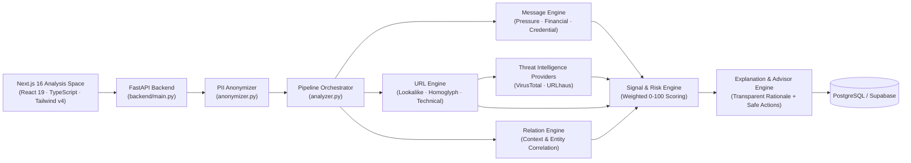

# SecureLink

> Evidence-based multi-signal scam & phishing analysis platform engineered around one core doctrine: **No proof, no certainty.**

**Live Application:** [securelink-puce.vercel.app](https://securelink-puce.vercel.app) · **License:** [MIT](./LICENSE) · **Security Policy:** [SECURITY.md](./SECURITY.md)

---

## Overview

**SecureLink** is an operational cybersecurity platform designed to analyze suspicious messages, URLs, and social-engineering scenarios before users click or share sensitive credentials. Instead of opaque black-box verdicts, SecureLink executes an independent multi-engine pipeline that correlates technical indicators, behavioral pressure tactics, and external threat intelligence into a transparent, weighted risk score (`0–100`) paired with clear explanations and prudent next actions.

---

## System Architecture



### Core Pipeline Modules (`backend/`)
- **`message_engine.py` & Knowledge Modules** (`pressure_knowledge.py`, `financial_knowledge.py`, `credential_knowledge.py`) — Detects urgency coercion, monetary solicitation, and OTP/credential harvesting indicators.
- **`url_engine.py` & `domain_knowledge.py` / `technical_knowledge.py`** — Inspects structural URL anomalies, lookalike/homoglyph domains, direct IP hosts, and non-standard ports.
- **`relation_engine.py` & `signal_engine.py`** — Correlates cross-signal relationships between message intent and linked domains to reduce isolated false positives.
- **`providers/`** — Real-time external threat reputation enrichment (**VirusTotal**, **URLhaus**).
- **`risk_engine.py`, `explanation_engine.py`, `advisor_engine.py` & `recommended_action.py`** — Computes weighted risk scores and synthesizes transparent, human-readable explanations and cautious recommendations.
- **`anonymizer.py`** — Strips/masks sensitive personal data before persistence and downstream processing.
- **`whatsapp_service.py`** — Messaging channel integration for real-world suspicious-message triage.

---

## Repository Structure

```text
securelink/
├── app/                # Next.js 16 App Router pages & Analysis Space UI
├── lib/                # Shared frontend utilities & API client helpers
├── backend/            # FastAPI multi-engine threat analysis backend + Dockerfile
│   ├── providers/      # External Threat Intelligence connectors (VirusTotal, URLhaus)
│   └── tests/          # Backend test suite
├── supabase/           # Database schema & migrations (PostgreSQL)
├── docs/               # Architecture notes & specifications
├── tests/              # End-to-end & integration tests
└── .env.example        # Required environment variables template
```

---

## Local Development

### Prerequisites
- **Node.js** `>= 20.x` & **npm** `>= 10.x`
- **Python** `>= 3.11` (or **Docker** for the backend container)

### 1. Environment Configuration
```bash
cp .env.example .env.local
# Populate Supabase credentials and external threat-intel API keys
```

### 2. Run the Frontend (Next.js 16)
```bash
npm install
npm run dev
# Available at http://localhost:3000
```

### 3. Run the Backend (FastAPI)
```bash
cd backend
pip install -r requirements.txt
uvicorn main:app --reload --port 8000
```

Or via Docker:
```bash
docker build -t securelink-backend ./backend
docker run --env-file .env.local -p 8000:8000 securelink-backend
```

---

## Security & Disclosure

SecureLink follows responsible disclosure practices. If you identify a vulnerability in the analysis pipeline, API, or frontend, please follow [SECURITY.md](./SECURITY.md) rather than filing a public issue.

## License

Released under the [MIT License](./LICENSE).
